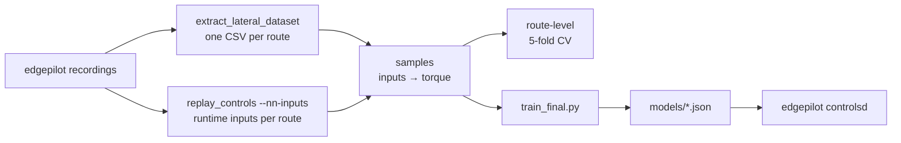

# edgepilot-nnlc

The training side of [edgepilot](https://github.com/cwal1220/edgepilot)'s
learned steering-torque feed-forward ([Lateral NN](https://github.com/cwal1220/edgepilot/blob/main/docs/lateral-nn.md)),
in the style of sunnypilot's Neural Network Lateral Control (NNLC). edgepilot
runs the model; this repository holds the data, trains the model and exports
the file edgepilot loads. sunnypilot has no model for the Kia K7 HEV, so this
one is trained from edgepilot's own drives, which are included
([`dataset/k7_hev`](dataset/k7_hev/README.md), 7.8 h usable).

- [Data format](docs/data-format.md): the CSV columns, units and signs.
- [Training for another car](docs/other-cars.md): recording, making the CSVs
  from edgepilot or other logs, the car values to set, the checks.

The model is an inverse steering model. It looks at a lateral-acceleration
trajectory around the moment the car responds, and gives the torque command
that produced it. In edgepilot the same model is fed the desired trajectory
and gives the feedforward torque. `k7_hev_v3` learns from the trajectory that
happened; `k7_hev_v4` learns from the inputs edgepilot's controller built at
each moment (runtime inputs), so training sees what the model sees on the road.



## Layout

| Path | What |
| --- | --- |
| `nnlc/csvdata.py` | reads the extractor CSVs and picks usable rows |
| `nnlc/series.py` | resamples each route to 100 Hz continuous segments |
| `nnlc/dataset.py` | builds samples from the trajectory that happened (`Spec`: lag, windows, extra inputs) and the left/right mirror |
| `nnlc/runtime.py` | builds samples from edgepilot's runtime inputs (`k7_hev_v4`), with a clock check per route |
| `nnlc/friction.py` | edgepilot's friction compensation share, recomputed from the recorded curvatures |
| `nnlc/models.py` | the MLP, sunnypilot's network shape, and the linear baseline |
| `nnlc/training.py` | training, sample weights and route-level cross-validation |
| `nnlc/configs.py` | the configurations in the results table, and the chosen one |
| `nnlc/export.py` | the model file edgepilot reads, and a numpy reference evaluator |
| `scripts/` | command-line steps (below) |
| `tests/` | sample alignment, runtime-input pairing, mirroring, export round-trip and the friction share |
| `models/` | exported models (`k7_hev_v3` and `k7_hev_v4`, both shipped by edgepilot) |
| `dataset/k7_hev/` | the K7 HEV drives, one gzipped CSV each and its runtime inputs (`.inputs.csv.gz`) |
| `docs/` | the data format and the guide for other cars |
| `examples/` | a quick start, a 30 s sample CSV, and a CSV writer for other logs |
| `data/`, `runs/` | local CSVs and experiment output (not tracked) |

## Setup

```sh
python3 -m venv .venv
.venv/bin/pip install -r requirements.txt
```

PyTorch uses the Apple GPU (MPS) when it is there; one cross-validation run
takes 10–20 s on an M5. Without a GPU it runs on the CPU, more slowly.

## Quick start

Coverage, cross-validation of the chosen setup and a trained model file from
the bundled data, into `runs/`:

```sh
examples/quickstart.sh
```

## Workflow

1. Turn edgepilot recordings into CSVs (for other logs see
   [Training for another car](docs/other-cars.md)):

   ```sh
   cmake --build ../edgepilot/build-host --target extract_lateral_dataset -j4
   scripts/extract_routes.sh ../edgepilot/build-host <recordings dir> dataset/<car>
   ```

   For the runtime-input setup (`k7_hev_v4`), also write each route's runtime
   inputs next to its CSV. This needs edgepilot's host tools and the
   recordings themselves, not only the CSVs:

   ```sh
   scripts/dump_runtime_inputs.sh ../edgepilot <recordings dir> dataset/<car>
   ```

2. See how much usable data there is, and check the signs:

   ```sh
   .venv/bin/python scripts/coverage.py dataset/k7_hev
   ```

3. Compare training setups with route-level 5-fold cross-validation:

   ```sh
   .venv/bin/python scripts/experiments.py dataset/k7_hev runs/exp.json
   ```

4. Train the chosen setup on every route and export it (the runtime-input
   setup; name `"A + mirror, 3 nets, friction-free"` for `v3`'s, which needs
   only the CSVs):

   ```sh
   .venv/bin/python scripts/train_final.py dataset/k7_hev models/k7_hev_v4.json
   ```

5. Run the tests:

   ```sh
   .venv/bin/python -m unittest discover -s tests -t .
   ```

## Samples

- **Target:** the torque edgepilot sent at time t (`tq_norm`: sign-corrected,
  divided by `steer_max`), minus the friction share edgepilot adds to the
  model in curves (the default, `Spec.friction_free`; see below). With
  `friction_free=False` it is the sent torque itself, as for the earlier
  `k7_hev_v2`.
- **Inputs:** counted from the response time t + lag (0.3 s), except the
  speed, which is taken at t.
  - Lateral acceleration `la = actual curvature × v²`, its jerk, and road
    roll.
  - `la` at −0.5…+1.5 s (13 points) and roll at −0.3…+1.5 s (7 points).
  - Steering angle at the response time and at −0.3…+1.5 s (7 points), and
    longitudinal acceleration.

  The controller's actual curvature comes from the steering angle through the
  vehicle model, as in upstream openpilot.
- **Usable rows:**
  - lateral control active and the EPS taking LKAS torque, with no EPS fault;
  - no lane change or blinker anywhere in the window;
  - driver torque under 100 and speed over 3 m/s;
  - fresh lateral acceleration and model data.

  Samples are taken at 20 Hz.
- **Friction-free target** (`Spec.friction_free`, the default; config "A +
  mirror, 3 nets, friction-free"): edgepilot adds its friction compensation to the model in
  curves, because the model does not see the tracking error. This target
  subtracts that same share from the torque, so the two do not overlap.
  `nnlc/friction.py` recomputes the share from the recorded desired and actual
  curvature with today's runtime values (0.55 s delay, friction 0.11, 1°
  deadzone fading 40→60 km/h). On the 10-16 route it matches the controller's
  own value (`replay_controls --dump`, field `fr`) within 0.7 raw on average.
  Older drives ran other controllers, so the share is what the runtime would
  add now, not what was applied then.
- **Mirror augmentation:** each training sample is also used flipped left to
  right. `la`, jerk and roll change sign, the angle flips about its zero, and
  the torque flips about the straight-driving bias.
- **Runtime inputs** (`Cfg.inputs = "runtime"`, `k7_hev_v4`): instead of the
  trajectory that happened, the inputs come from `<route>.inputs.csv.gz`. These
  are the values edgepilot's controller built from the recorded plan and its
  history at each 20 Hz tick, written by `replay_controls --nn-inputs` (open
  loop: the planner and controller run on the recorded model output and CAN).
  Each row is paired with the nearest 100 Hz point of the route's CSV (within
  6 ms) for the target and the usable rows. Before that, `nnlc/runtime.py`
  checks the two clocks: the ESP12 longitudinal acceleration is in both
  files, and its correlation has to peak at 0 (within 30 ms), or the route is
  skipped with a message. The 25 K7 drives with runtime inputs peak at 0 ms;
  the 26th has no usable rows and an empty file.

## Results (2026-10-16)

The data is 26 drives from 2026-09-25 to 10-15: 11.5 h recorded, 9.0 h with
lateral control active, and 7.8 h usable (25 drives give samples). Most of it
is 36–108 km/h with |la| < 1 m/s². Only about 3 minutes are above 1.5 m/s².

Cross-validation sorts the drives by date and splits them into five folds of
similar size, so every drive is held out once. The table gives the torque
RMSE (fraction of `steer_max`) averaged over the folds, against a
torqued-style linear model `a·la + b·roll + c·friction + d` fitted on the same
folds (0.0604 overall, 0.1187 at |la| ≥ 1).

| Setup | RMSE | \|la\| ≥ 1 | vs linear |
| --- | ---: | ---: | ---: |
| sunnypilot network (18 inputs, sigmoid) | 0.0506 | 0.0951 | +16 % |
| MLP 32×32 tanh, sunnypilot's 18 inputs | 0.0479 | 0.0895 | +21 % |
| + steering-angle window, denser `la` window, longitudinal accel (33 inputs) | 0.0429 | 0.0830 | +29 % |
| + mirror augmentation | 0.0423 | 0.0808 | +30 % |
| + three nets averaged (`k7_hev_v2`) | 0.0414 | 0.0777 | +31 % (+35 % at \|la\| ≥ 1) |

These rows use the sent torque as the target (`friction_free=False`). The
chosen setup since 2026-10-17 trains the same network on the friction-free
target (`k7_hev_v3`). The model then needs the controller's friction term, so
it is compared together with it. Against the torque that was sent, held out
by the same folds (RMSE and the bias in the curve's direction, in raw torque
units of 384, |la| ≥ 0.5):

| Phase | v2 alone | v2 + curve friction | **v3 + curve friction (chosen)** |
| --- | ---: | ---: | ---: |
| entry | 28.0 (−1.3) | 34.3 (+11.3) | **32.3 (−0.5)** |
| hold | 23.4 | 25.4 | **24.2** |
| exit | 23.2 (−1.6) | 31.0 (−14.9) | **25.7 (−2.7)** |
| straight | 14.0 | 14.0 | **14.3** |

v2 with the friction counts it twice: too much torque at curve entries, too
little at exits. v2 alone explains the sent torque best, but it cannot react
to the tracking error, and on the 2026-10-16 drive the car fell behind at
curve entries.

## Results (2026-10-18): curve entries, runtime inputs, curve gain

On the road (10-16, 10-18) the model fell behind at curve entries, where the
linear feed-forward did not. Measured in edgepilot's closed-loop replay (six
drives of 10-12 to 10-18, 58 free-running minutes; curve phases as the
simulated path's lateral acceleration over the desired one):

- **The fit is not the problem.** Over the entry samples of its training data,
  `v3`'s mean prediction is 1.01 of the torque that was sent (hold 1.00, exit
  0.99); the linear model gives 0.84 and 1.08.
- **Training for entries changes nothing.** Entry weights (×4, ×10), entry and
  exit weights, a loss that counts too little torque at entries 2–4 times,
  smoothed inputs, lateral acceleration from the yaw rate, a 64×64 network,
  80 epochs and windows ending at +0.9 or +0.6 s all leave the replay's entry
  at 0.88–0.89 (`v3` 0.886; another seed 0.889). Every model trained on what
  happened gives the same feed-forward at the simulated entries (0.75 m/s²
  against the linear feed-forward's 0.87).
- **The runtime inputs differ.** At curve entries the plan's window is flatter
  than what the car did (12 % larger near, 5–7 % smaller far), the jerk input
  correlates with the trajectory's at r = 0.17, and the angle inputs run 8 %
  high. Training on the runtime inputs (`k7_hev_v4`) puts the training and the
  road on the same inputs, but its target is the torque that was sent, so it
  cannot learn more than the old controller gave either. Without the steering
  angle, whose runtime value does not pair with `la` as the measured one did,
  the lane position on straights is closer to the linear feed-forward's.
- **The curve gain closes the entry.** edgepilot multiplies the model's output
  by 1 + `curve_gain` in curves (0.2→0.6 m/s², 30→50 km/h). It is calibrated
  in the replay after training: 0.3 for both models (0.4 overshoots at exits).

| Feed-forward | Entry | Held | Exit | Lane RMS, straight | In curves | Torque step RMS |
| --- | ---: | ---: | ---: | ---: | ---: | ---: |
| linear | 0.93 | 0.94 | 0.97 | 11.7 cm | 25.8 cm | 2.66 |
| `v3` | 0.89 | 0.92 | 0.95 | 12.8 cm | 27.9 cm | 2.28 |
| `v3` + curve gain 0.3 | 0.93 | 0.95 | 0.97 | 12.7 cm | 28.4 cm | 2.31 |
| `v4` + curve gain 0.3 | 0.94 | 0.95 | 0.96 | 11.7 cm | 25.5 cm | 2.25 |

The three drives of 10-16 and 10-18 are in neither model's training. On them
alone `v4` + gain holds curves worse than `v3` + gain (31.1 against 29.0 cm);
its gain in the table comes from the drives it was trained on. `v4`'s
cross-validated RMSE is 0.0537, +7.5 % on the linear model, not comparable
with `v3`'s: the plan does not determine the PID's share of the sent torque.

The study of 2026-10-16 also tried these, on the earlier extraction and folds
(their configurations are in commit 46f08f5):

- **No real effect:** network size alone, SiLU, Huber loss, sample
  weighting, weight decay, 50 Hz sampling, training only on cleaner data, and
  the driver torque as an input.
- **Worse:** a linear-plus-MLP model and sunnypilot's network.
- **Costs the most to remove:** the past `la` window.

Without the mirror, a larger model flattened out at 30 m/s for positive `la`,
outside the data. With it, the steady-state curves are monotonic and symmetric
about a small straight-driving bias (+0.03) at every speed.

The first model, `k7_hev_v1`, was trained on the CSVs read in file order. That
order dropped 13 % of the samples (see edgepilot `docs/diagnostics.md`). It and
`k7_hev_v2`, which learned the sent torque with the friction in it, were removed
from `models/` on 2026-10-17; git history keeps them, and every edgepilot route
keeps the model it ran as `models/lateral_nn.json`.

## Model file

`models/<car>_v<version>.json`, format `edgepilot-lateral-nn` version 1
(`nnlc/export.py`). edgepilot keeps the same names in `models/lateral_nn/`;
its web console lists them by file name and switches between them.


- `features` and `spec`: input order and window definition. Inputs go in
  their own units.
- `input_mean`, `input_std`: inputs are normalised as `(x − mean) / std`.
- `nets`: an ensemble; each has `layers` with `weight` [out][in], `bias` and
  `activation` (`tanh` or `linear`). The outputs are averaged, then clipped to
  `output_clip`.
- `curve_gain`: edgepilot multiplies the model's output by 1 + `curve_gain`
  in curves (|desired lateral acceleration| 0.2→0.6 m/s², 30→50 km/h). It is
  not used in training; the configuration's `Cfg.curve_gain` holds the value
  calibrated in edgepilot's closed-loop replay. edgepilot refuses a value
  outside 0 to 1 and takes a file without it as 0.
- `linear`, `angle_model`: the linear baseline and the fitted
  `angle = a·la/v² + b·la + c`, for checks.
- `test_vectors`: inputs and expected outputs. edgepilot evaluates them when
  it loads the file and refuses it if any differs.
- `input_tests`: a synthetic trajectory and the inputs `dataset.rows` builds
  from it. edgepilot's unit test feeds the trajectory to its run-time input
  code and expects the same inputs.

The file is strict JSON: a metric without a value is `null`, never `NaN`,
which edgepilot's reader refuses. `train_final.py` stops before training a
configuration edgepilot cannot read: anything but the MLP, extra inputs other
than angle and longitudinal acceleration, or windows reaching beyond its 1 s
history or its plan.

At run time the response-time inputs come from the desired trajectory:

- **`la`, jerk:** from the plan's desired curvature × v² at t + lag + offset;
  past points come from the history of desired `la`.
- **Angle:** from the inverse vehicle model with the live steer ratio,
  stiffness and angle offset. Training `la` was computed from the angle the
  same way.
- **Roll, longitudinal accel, speed:** the current values. Training took the
  speed at t, but the longitudinal accel at the response time.

A runtime-input model (`k7_hev_v4`) trains on exactly these values.

## Caveats

- The numbers say how well the model explains the torque edgepilot actually
  sent. The data is closed-loop, so the model may have learned part of the
  feedback. Only a road comparison shows whether driving gets better.
- A runtime-input model learns the closed-loop torque of the controller that
  drove, PID included, for the plan it followed. A replay of its own training
  drives therefore flatters it; judge it on drives it did not see.
- Above 1.5 m/s² there are about 3 minutes of data. The mirror keeps the
  curves sane there, but their accuracy is unverified. Engaged drives on ramps
  and winding roads would help.
- The torque-to-angle delay measured from the data is 0.1–0.3 s, while
  edgepilot's learned lateral delay is about 0.55 s. The runtime reads the plan
  at the model's own offsets.
- Speeds below 3 m/s are not in the data; edgepilot falls back to its linear
  feed-forward there.
- The mirror flips angles about one zero fitted over all drives, though each
  drive's zero differs by up to 0.5°; fitting it per drive changed nothing
  measurable.
