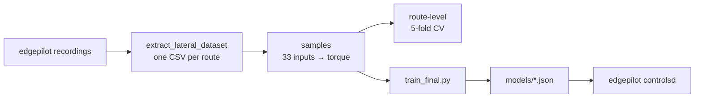

# nnlc

A learned steering-torque model for [edgepilot](https://github.com/cwal1220/edgepilot)
on the Kia K7 HEV, in the style of sunnypilot's Neural Network Lateral Control
(NNLC). sunnypilot has no model for this car, so this repository trains one
from edgepilot's own recordings.

The model is an inverse steering model. It looks at a lateral-acceleration
trajectory around the moment the car responds, and gives the torque command
that produced it. In edgepilot the same model is fed the desired trajectory
and gives the feedforward torque.



## Layout

| Path | What |
| --- | --- |
| `nnlc/csvdata.py` | reads the extractor CSVs and picks usable rows |
| `nnlc/series.py` | resamples each route to 100 Hz continuous segments |
| `nnlc/dataset.py` | builds samples (`Spec`: lag, windows, extra inputs) and the left/right mirror |
| `nnlc/models.py` | the MLP, sunnypilot's network shape, and the linear baseline |
| `nnlc/training.py` | training, sample weights and route-level cross-validation |
| `nnlc/configs.py` | every configuration compared on 2026-10-16, and the chosen one |
| `nnlc/export.py` | the model file edgepilot reads, and a numpy reference evaluator |
| `scripts/` | command-line steps (below) |
| `tests/` | sample alignment, mirroring and export round-trip |
| `models/` | exported models (tracked) |
| `data/`, `runs/` | CSVs and experiment output (not tracked) |

## Setup

```sh
python3 -m venv .venv
.venv/bin/pip install -r requirements.txt
```

PyTorch uses the Apple GPU (MPS) when it is there; one cross-validation run
takes 10–20 s on an M5.

## Workflow

1. Build the extractor in edgepilot and turn the recordings into CSVs:

   ```sh
   cmake --build ../edgepilot/build-host --target extract_lateral_dataset -j4
   scripts/extract_routes.sh ../edgepilot/build-host ../experiments data
   ```

2. See how much usable data there is:

   ```sh
   .venv/bin/python scripts/coverage.py data
   ```

3. Compare training setups with route-level 5-fold cross-validation:

   ```sh
   .venv/bin/python scripts/experiments.py data runs/exp.json "A + mirror" "base mlp32 tanh"
   ```

4. Train the chosen setup on every route and export it:

   ```sh
   .venv/bin/python scripts/train_final.py data models/k7_hev_v1.json
   ```

5. Run the tests:

   ```sh
   .venv/bin/python -m unittest discover -s tests -t .
   ```

## Samples

- **Target:** the torque edgepilot sent at time t (`tq_norm`: sign-corrected,
  divided by `steer_max`).
- **Inputs:** taken at the response time t + lag (0.3 s), with windows counted
  from there.
  - Speed, lateral acceleration `la = actual curvature × v²`, its jerk, and
    road roll.
  - `la` at −0.5…+1.5 s (13 points) and roll at −0.3…+1.5 s (7 points).
  - Steering angle now and at −0.3…+1.5 s (7 points), and longitudinal
    acceleration.

  The controller's actual curvature comes from the steering angle through the
  vehicle model, as in upstream openpilot.
- **Usable rows:**
  - lateral control active and the EPS taking LKAS torque, with no EPS fault;
  - no lane change or blinker anywhere in the window;
  - driver torque under 100 and speed over 3 m/s;
  - fresh lateral acceleration and model data.

  Samples are taken at 20 Hz.
- **Mirror augmentation:** each training sample is also used flipped left to
  right. `la`, jerk and roll change sign, the angle flips about its zero, and
  the torque flips about the straight-driving bias.

## Results (2026-10-16)

The data is 26 drives from 2026-09-25 to 10-15: 11.5 h recorded, 9.0 h with
lateral control active, and 7.2 h usable. Most of it is 36–108 km/h with
|la| < 1 m/s². Only about 3 minutes are above 1.5 m/s².

Cross-validation leaves out whole drives in five folds. The table gives the
torque RMSE (fraction of `steer_max`) averaged over the folds, against a
torqued-style linear model `a·la + b·roll + c·friction + d` fitted on the same
folds.

| Setup | RMSE | \|la\| ≥ 1 | vs linear |
| --- | ---: | ---: | ---: |
| sunnypilot network (18 inputs, sigmoid) | 0.0511 | 0.0956 | +15 % |
| MLP 32×32 tanh, sunnypilot's 18 inputs | 0.0479 | 0.0873 | +20 % |
| + steering-angle window, denser `la` window, longitudinal accel (33 inputs) | 0.0430 | 0.0805 | +28 % |
| **+ mirror augmentation (chosen)** | **0.0425** | **0.0761** | **+29 %** (+34 % at \|la\| ≥ 1) |

What did not help: network size alone, SiLU, Huber loss, sample weighting,
weight decay, 50 Hz sampling, training only on cleaner data, and the driver
torque as an input. A linear-plus-MLP model and sunnypilot's network were
worse. Dropping the past `la` window costs the most.

Without the mirror, a larger model flattened out at 30 m/s for positive `la`,
outside the data. With it, the steady-state curves are monotonic and symmetric
about a small straight-driving bias (+0.03, likely road crown) at every speed.

## Model file

`models/*.json`, format `edgepilot-lateral-nn` version 1 (`nnlc/export.py`):

- `features` and `spec`: input order and window definition. Inputs go in
  their own units.
- `input_mean`, `input_std`: inputs are normalised as `(x − mean) / std`.
- `nets`: an ensemble; each has `layers` with `weight` [out][in], `bias` and
  `activation` (`tanh`, `silu` or `linear`). The outputs are averaged, then
  clipped to `output_clip`.
- `linear`, `angle_model`: the linear baseline and the fitted
  `angle = a·la/v² + b·la + c`, for checks.
- `test_vectors`: inputs and expected outputs for a C++ unit test.

At run time the response-time inputs come from the desired trajectory:

- **`la`, jerk:** from the plan's desired curvature × v² at t + lag + offset;
  past points come from the history of desired `la`.
- **Angle:** from the inverse vehicle model with the live steer ratio,
  stiffness and angle offset. Training `la` was computed from the angle the
  same way.
- **Roll, longitudinal accel, speed:** the current values.

## Caveats

- The numbers say how well the model explains the torque edgepilot actually
  sent. The data is closed-loop, so the model may have learned part of the
  feedback. Only a road comparison shows whether driving gets better.
- Above 1.5 m/s² there are about 3 minutes of data. The mirror keeps the
  curves sane there, but their accuracy is unverified. Engaged drives on ramps
  and winding roads would help.
- The torque-to-angle delay measured from the data is 0.1–0.3 s, while
  edgepilot's learned lateral delay is about 0.55 s. The runtime has to pick
  which plan time feeds the model.
