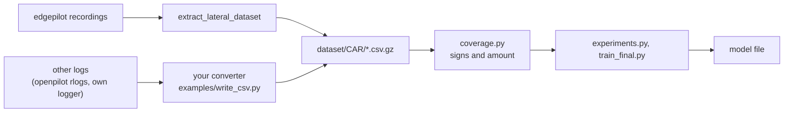

# Training for another car

[← README](../README.md)

nnlc learns one car's steering from that car's own drives. The bundled data
is a Kia K7 HEV (`dataset/k7_hev`). For another car you need drives with
lateral control engaged, the same CSV columns ([Data format](data-format.md)),
and a few car values in the code.



## 1. Record

- Drive with lateral control engaged, hands resting lightly or off. Rows where
  the driver torque passes `Spec.driver_thr` are dropped.
- Cover speeds and curves. The K7 set has about 8 h of usable driving but only
  about 3 minutes above 1.5 m/s² ([dataset/k7_hev](../dataset/k7_hev/README.md)).
  Ramps and winding roads are worth more than motorway miles.
- Use one controller and one set of steering values through the drives where
  you can. The model learns the torque that was sent, so it inherits the
  controller that drove.

## 2. Make the CSVs

**From edgepilot recordings:** build the extractor and run it over the
routes. The first argument of `extract_lateral_dataset` is the output CSV.

```sh
cmake --build <edgepilot>/build-host --target extract_lateral_dataset -j4
scripts/extract_routes.sh <edgepilot>/build-host <recordings dir> dataset/<car>
gzip -9 dataset/<car>/*.csv
```

edgepilot decodes the K7's CAN (MDPS12, ESP12). On another car its CAN
decoding has to be ported first; the columns stay the same.

The chosen setup (`k7_hev_v4`'s) also needs each route's runtime inputs, the
values edgepilot's controller built from the plan at each moment. Only
edgepilot's `replay_controls` can make them, from the recordings:

```sh
scripts/dump_runtime_inputs.sh <edgepilot> <recordings dir> dataset/<car>
```

Without edgepilot recordings, train the setup that needs only the CSVs,
`"A + mirror, 3 nets, friction-free"` (`k7_hev_v3`'s).

**From other logs:** write the columns yourself.
[`examples/write_csv.py`](../examples/write_csv.py) takes one array per column,
checks lengths and time order, fills the optional columns and writes the
file. Run its demo to see the round trip:

```sh
.venv/bin/python examples/write_csv.py --demo /tmp/nnlc_demo
.venv/bin/python scripts/coverage.py /tmp/nnlc_demo
```

For openpilot or sunnypilot rlogs, these fields give the required columns.
The names are those of openpilot's `cereal` around 0.9–0.10; check them
against your version. openpilot's curvature and torque are left-positive, so
negate them for the right-positive columns.

| Column | rlog source |
| --- | --- |
| `t` | `logMonoTime` / 1e9, minus the first |
| `v` | `carState.vEgo` |
| `active` | `carControl.latActive` |
| `desire` | nonzero while `modelV2.meta.laneChangeState` is not off |
| `angle` | `carState.steeringAngleDeg` |
| `driver_tq` | `carState.steeringTorque` (car units; set `Spec.driver_thr` to match) |
| `apply_tq` | `carOutput.actuatorsOutput.torque` × steer max (left +) |
| `des_curv` | −`controlsState.desiredCurvature` |
| `act_curv` | −`controlsState.curvature` |
| `long` | `carState.aEgo` |
| `roll` | −`liveParameters.roll` |
| `model_age` | seconds since the last `modelV2` |
| `toi_active` | 1 while the EPS takes the torque (latActive, no steer fault) |
| `steer_fault` | `carState.steerFaultTemporary` |
| `blinker` | `carState.leftBlinker` or `rightBlinker` |
| `eps_out_tq` | `carState.steeringTorqueEps`, optional |
| `nn_ff` | 1 where a learned feed-forward drove the tick, else 0 |

Put the files in `dataset/<car>/`, gzipped or not, named by date
(`YYYY-MM-DD--hh-mm-ss-mmm`). Cross-validation folds the drives in name order.

## 3. Set the car values

| Where | What | K7 HEV |
| --- | --- | --- |
| your converter, or edgepilot `SteeringParams.steer_max` | torque normalisation of `tq_norm` | 384 |
| `nnlc/dataset.py` `Spec.driver_thr` | driver torque above which a row is dropped, in your units | 100 |
| `nnlc/friction.py` `STEER_RATIO`, `WHEELBASE`, `MASS`, `CENTER_TO_FRONT_RATIO`, `STIFFNESS_FACTOR` | vehicle model for the friction deadzone | 16.3, 2.855 m, 1816 kg, 0.4, 1.0 |
| `nnlc/friction.py` `FRICTION`, `DELAY_S`, `DEADZONE_DEG` | the runtime's friction, lateral delay and deadzone | 0.11, 0.55 s, 1° |

The friction values matter only for the default friction-free target: the
target subtracts the friction share that the runtime adds to the model in
curves. They must match the controller that will use the model. If your
runtime does not add that friction term, train with `friction_free=False` (the
sent torque as the target).

## 4. Check, compare, train

```sh
.venv/bin/python scripts/coverage.py dataset/<car>
.venv/bin/python scripts/experiments.py dataset/<car> runs/<car>.json
.venv/bin/python scripts/train_final.py dataset/<car> models/<car>_v1.json
# from CSVs only:
.venv/bin/python scripts/train_final.py dataset/<car> models/<car>_v1.json "A + mirror, 3 nets, friction-free"
```

- **`coverage.py`:** hours per drive, usable minutes on a speed × lateral
  acceleration grid, and two sign checks. `tq~la` must be positive. A
  negative `tq~eps` means the EPS torque column has the other sign.
- **`experiments.py`:** route-level 5-fold cross-validation of the setups in
  `nnlc/configs.py`, against a linear model fitted on the same folds.
- **`train_final.py`:** trains the chosen setup on every drive and exports
  it. The steady-state table it prints should rise monotonically and be
  symmetric about a small straight-driving bias. It writes the setup's
  `curve_gain` into the file; that value was calibrated for the K7 in
  edgepilot's closed-loop replay, so recalibrate it for another car (set it in
  `nnlc/configs.py`, or 0 to start without).

## 5. Use the model

The file is edgepilot's `edgepilot-lateral-nn` format
([README](../README.md#model-file)). In edgepilot it goes to
`models/lateral_nn/<car>_v<version>.json`. The web console lists every file
in that folder by name and switches to the one you pick on the Steering tab,
with `nn_feedforward` on.
Pick only the model of the car it was trained on. Another runtime can follow
`nnlc/export.py`'s `evaluate`, the numpy reference, and must build the inputs
the same way: `input_tests` in the file holds a trajectory and the inputs that
belong to it.
